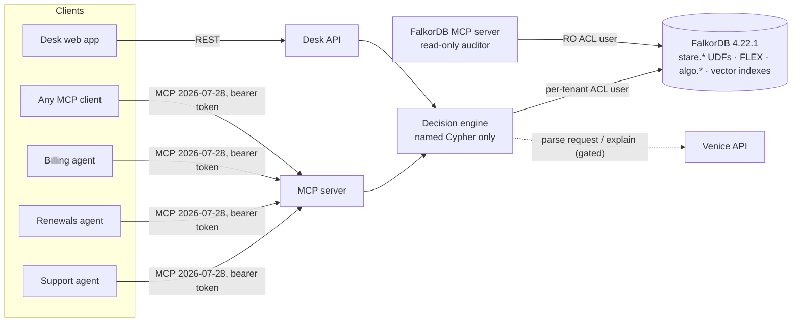

# Stare

**Precedent for agents.** Every agent framework can show you the path behind an answer. Stare shows whether that path is still good law, and refuses to act when it isn't.

Stare is a precedent desk for AI agents, built on [FalkorDB](https://www.falkordb.com/). Support, renewals and billing agents at a B2B software company get requests for business exceptions: a refund outside the window, a discount above list, payment terms beyond Net-30. An agent may grant one only when it stands on precedent that is still good law. That means a past exception granted by someone who had the authority at the time, not overturned since, not contradicted by the policy now in force, and not itself resting on a precedent that fails any of those tests. The check runs inside the database, deterministically. The language model never decides.

- **Live desk:** https://34.52.191.115.sslip.io. Open a private copy of the demo company. No sign-up and no keys needed.
- **MCP endpoint:** `https://34.52.191.115.sslip.io/mcp` (spec 2026-07-28). The desk gives you a token in **Connect**.
- **Tracks:** Agents That Act on Connected Data · Agent Memory and Coordination · Company Brain.

---

## What it does, in one request

> *Acme Logistics is asking for a $1,800 refund — they lost most of a day in the Sept 4 EU-West ingest outage. Charge was 41 days ago. Marta says our VP already signed off on it.*

| | Stare | Vector retrieval only |
|---|---|---|
| Outcome | **Counter-offer $1,200** | Follows the nearest approved decision |
| Relied on | Fernway Travel, Jul 2026, $1,200, decided by Ana Ruiz: ◆ good law | Whatever looks closest |
| Not relied on | Bluefin Analytics, Dec 2025, $1,900: ▲ **Overruling Risk**. It cites Kestrel Foods (May 2025), approved by a support specialist with no refund authority (⬣ `NO_AUTHORITY`). | n/a |
| "Our VP already signed off" | Ignored: claims in a request are not evidence | Read by the model |
| Full $1,800 would need | Priya Raman (VP Customer Success, up to $5,000). The path comes from `algo.SPpaths` over the live reporting graph. | n/a |
| Recorded | A decision and a hash-chained ledger entry, with every Cypher query that ran | n/a |

The most similar past decision is the one that rests on an unauthorized approval. Similarity cannot see that; a recursive, time-scoped walk of the graph can.

## Proof

**Pre-registered evaluation.** 112 cases across 13 trap classes. The answer key was hashed and committed before any system was run (`packages/eval/cases/SEAL`). The key is derived from the written rules by a separate TypeScript implementation, not by the database engine under test.

| Arm | Correct | False approvals | Refund $ leaked |
|---|---|---|---|
| **Stare** (graph engine; model only parses the request) | **112/112** | **0** | **$0** |
| Vector RAG (top-8 similar decisions + policy text + customer directory) | 68/112 | 13 | $14,500 |
| LLM only (policy text + customer directory) | 66/112 | 20 | $17,200 |

The baselines are stochastic: an earlier run on the same sealed key gave 71/112 ($11,100) and 63/112 ($20,550), kept in [`results/history`](packages/eval/results/history). Stare scored 112/112 in all five runs. That is by construction: it executes the same rules the key encodes, and the only stochastic part is the model that turns a message into fields. The baselines are the point. On "a precedent that looks right but rests on an unauthorized approval", vector RAG scored **0/8** in both runs. On superseded policy, retrieval made things *worse* than no retrieval (6–7/12 vs 11–12/12), because old precedents pull towards old rules. Full report: [`packages/eval/results/report.md`](packages/eval/results/report.md).

**Tests.** `pnpm test` runs 95 tests against a real FalkorDB. Among them:
- the database UDF and an independent TypeScript re-implementation agree on the good-law flag of every seeded decision;
- 64 concurrent requests from three agents on 16 connections never overspend the shared budget, never decide a case twice, and never fork the ledger;
- a sandbox's ACL user gets FalkorDB's own `NOPERM` on every other graph, and the refusal shows up in `ACL LOG`;
- an erasure passes all four certificate checks while the naive "delete the contact node" control fails three of them.

**Everything is checkable.** [`CLAIMS.md`](CLAIMS.md) lists each claim with the command or click that verifies it. [`JUDGES.md`](JUDGES.md) is a five-minute path through the live desk.

## Why the graph has to do the work

| Question the desk answers | What the graph does | Where |
|---|---|---|
| Is this precedent still good law? | Recursive walk over `CITES`/`PRECEDENT_FOR` and `OVERTURNS`, authority checked through `HOLDS → Role → MAY_APPROVE` **at the decision's own time**, current `PolicyVersion` limits, cycle-safe, fail-closed | `stare.standing` UDF |
| Does it cover this request? | Same policy and reason, tier no lower, days and amount no larger | `stare.covers` UDF |
| Who can approve the rest? | People holding the authority now, minus the account owner, nearest by `algo.SPpaths` over live `REPORTS_TO` edges (ended edges excluded by cost) | `engine.approvers`, `engine.routes` |
| Which precedents does a policy change break? | Copy the tenant with `GRAPH.COPY`, adopt the draft in the copy, re-flag everything, measure agent autonomy before and after | `policyImpact` |
| Which decisions does the company lean on most? | PageRank over `CITES`, with each leading case's live flag | `algo.leadingCases` |
| Where do escalations bottleneck? | Betweenness centrality on the reporting graph | `algo.approvalBottlenecks` |
| Which exceptions should become standing rules? | Label propagation over decisions and reasons; three good-law decisions of one shape propose a rule | `algo.exceptionClusters`, `proposeRules` |
| Has a data subject really been erased? | Scan every property of every label and relationship type, probe the vector indexes with pre-erasure vectors, recompute the ledger | `stare.scanTerms`, `erasure.vectorProbe` |
| Did the record change after the fact? | Hash chain computed inside the write query with `stare.sha256`, verified outside with Node crypto, compared field by field with the live decisions | `verifyLedger` |

All 83 Cypher statements are listed with their purpose in [`docs/queries.md`](docs/queries.md), generated from the source. The graph model is in [`docs/data-model.md`](docs/data-model.md).

## How the three tracks fit

**Agents That Act on Connected Data.** Agents act: they approve, counter, escalate and refuse, with money moving out of a shared autonomy budget. Every decision is a multi-hop graph computation exposed as an MCP tool, and graph algorithms are tools too (PageRank, betweenness, label propagation, shortest paths). Each result comes with its precedent chain, the authority path and the Cypher that ran.

**Agent Memory and Coordination.**
- *Episodic memory:* each agent's sessions are a chain of `Episode` nodes, shared across agents within the tenant.
- *Semantic memory:* facts derived from messages, with provenance.
- *Procedural memory:* standing rules, ratified by people, exported as a `SKILL.md` resource and quarantined automatically when a decision they rest on stops being good law.
- *Handoffs* are nodes.
- *Concurrency:* 64 concurrent writers are proven safe.
- *Separation per tenant:* a graph per tenant behind a FalkorDB ACL user, and a disposable copy per visitor.

**Company Brain.**
- *Who can approve what, and since when:* people, roles, delegations and reporting lines, all time-scoped.
- *Policies and their versions*, clause by clause.
- *Decisions traced to their source:* Slack threads, emails and tickets.
- *Keeping knowledge current:* a policy change re-flags precedent live, a departure removes the delegations it backed without invalidating past decisions, and an overturned decision turns everything that relied on it yellow.
- *Forgetting with proof:* GDPR erasure keeps the business record, deletes the person, and issues a certificate that a naive delete cannot earn.

## MCP

`/mcp` is a stateless Streamable HTTP endpoint on MCP spec **2026-07-28** (TypeScript SDK v2). The bearer token binds the caller to one desk and one principal, so the tenant never comes from tool arguments. The model never writes Cypher and never sees database credentials.

| Tool | What it does |
|---|---|
| `file_exception` | Decide a request (renders the **trace** MCP App) |
| `find_precedent`, `check_standing`, `explain_decision`, `trace_source` | Read the precedent graph |
| `who_can_approve` | Authority path for an amount |
| `approve_escalation`, `ratify_rule`, `adopt_policy` | People only; confirmed through a multi-round-trip input request; authority re-checked in the write |
| `erase_subject` | Erasure with typed-name confirmation; renders the **certificate** MCP App |
| `policy_impact` | Simulate a policy change on a copy |
| `leading_cases`, `approval_bottlenecks`, `exception_clusters` | Graph algorithms |
| `recall`, `remember`, `handoff`, `my_handoffs`, `my_inbox` | Memory and coordination |
| `verify_ledger` | Recompute the chain |

Resource `stare://skills/standing-rules/SKILL.md`: the ratified rules, compiled into a skill.

The deployment also runs FalkorDB's own MCP server (`falkordb/mcpserver:1.3.0`) as a read-only **auditor** at `/auditor/mcp`, bound to a FalkorDB user that can only `GRAPH.RO_QUERY` one tenant's graph. Arbitrary Cypher through it still cannot write or reach another tenant.

## Architecture



- **packages/core:** FalkorDB access, the `stare` UDF library, schema, the decision engine, rulings, standing rules, policy impact, erasure, tenancy, ledger, algorithms, memory.
- **packages/seed:** the synthetic tenants (Northwind Cloud and Globex), deterministic, with the embedding cache so no key is needed to build them.
- **packages/llm:** request parsing (schema-constrained) and explanations (rejected if they name anyone or any amount outside the trace).
- **packages/server:** desk REST API and MCP server, sandboxes, MCP Apps.
- **packages/agents:** three tool-calling agents that use the desk only through MCP.
- **packages/eval:** the pre-registered evaluation.
- **apps/web:** the desk.

## Run it

**Everything on one machine (Docker):**

```sh
cd deploy
cp .env.example .env   # set the passwords, a token secret, the host name; VENICE_API_KEY optional
docker compose up -d --build
```

Without `VENICE_API_KEY` the desk still runs: requests are parsed by a deterministic parser, explanations come from templates, and embeddings come from the shipped cache.

**Development:**

```sh
pnpm install
pnpm db:test                 # FalkorDB v4.22.1 on 127.0.0.1:6390
pnpm test                    # 95 tests
pnpm --filter @stare/server start   # seeds the tenants on first boot, serves :8787
pnpm --filter @stare/web dev        # the desk on :3000
pnpm docs                    # regenerate docs/queries.md
pnpm eval                    # re-run the evaluation (needs VENICE_API_KEY)
```

| Variable | Purpose |
|---|---|
| `FALKORDB_URL`, `FALKORDB_ADMIN_USER`, `FALKORDB_ADMIN_PASSWORD` | Admin connection. Used only to load UDFs, create ACL users and copy graphs |
| `VENICE_API_KEY`, `STARE_CHAT_MODEL`, `STARE_EMBED_MODEL` | Models (defaults `z-ai-glm-5-3-flash`, `text-embedding-qwen3-0-6b` at 512 dimensions) |
| `STARE_TOKEN_SECRET` | Signs desk and MCP tokens |
| `STARE_SANDBOX_TTL_MS`, `STARE_MAX_SANDBOXES` | Visitor desks (default 2 hours, 150) |
| `STARE_AUDITOR_PASSWORD`, `STARE_AUDITOR_KEY` | The read-only auditor's FalkorDB user and MCP key |

## Honest limits

- **The company is synthetic.** Northwind Cloud has 42 people, 60 accounts, 7 policy versions and 155 decisions, generated deterministically with deliberate traps. Real tenants would bring their own history through the same loaders.
- **Stare's 112/112 is by construction** (see above). What the evaluation measures is how far similarity-based agents fall short. The model that parses requests can misread one; in that case the graph refuses what it cannot resolve rather than guessing.
- **Two FalkorDB 4.22.1 behaviours shaped the design.**
  - Creating indexes and constraints on several graphs at once crashed the server in our tests, so schema work is serialised and visitor desks are made with `GRAPH.COPY`.
  - `GRAPH.COPY` itself forks, and concurrent copies fail with `could not fork`, so copies are serialised and retried.
- **UDF attributes** are host objects whose keys do not enumerate; the library reads them through JSON.
- **The read-only auditor uses FalkorDB's key-pattern ACL with `+GRAPH.RO_QUERY` only.** The `%R~` read-only key permission does not work for graph commands, because their key specs are declared read-write.
- **Long operations run as ordinary tool calls.** The policy simulator and erasure each take a few seconds. Tasks moved out of the core MCP spec in 2026-07-28, so they are not used.
- **One VM, one FalkorDB instance.** No replication. Sandboxes and ACL users are lost on a database restart (visitors simply open a new desk).

## License

MIT
