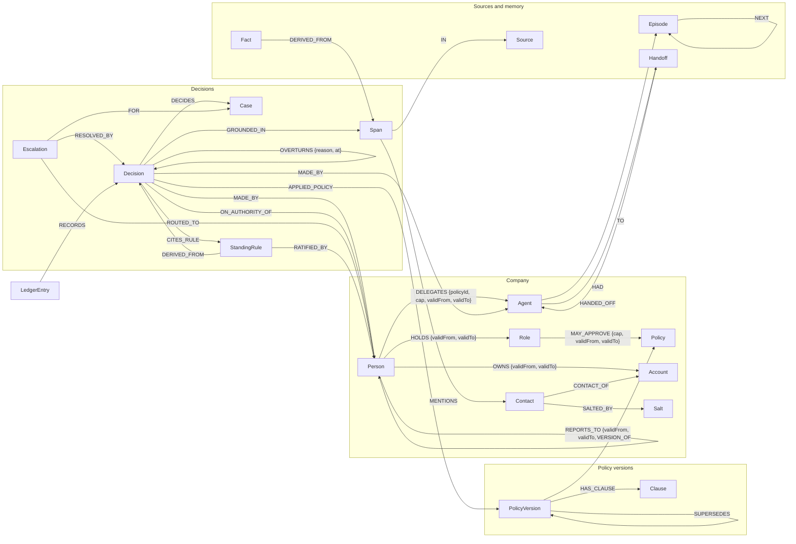

# Graph data model

One FalkorDB graph per tenant (`stare:<tenant>`), a pristine template per tenant (`stare:tpl:<tenant>`), and one disposable copy per visitor (`stare:sbx:<id>`). Every time is an epoch-millisecond integer; open intervals end at `253402300799000` (9999-12-31), because FalkorDB does not store nulls.

## Nodes

| Label | Key properties | Notes |
|---|---|---|
| `Person` | `id, name, title, joinedAt, leftAt` | Leaving sets `leftAt` and closes every edge below; past decisions are untouched. |
| `Role` | `id, name` | Authority is on the role, valid over an interval. |
| `Agent` | `id, kind, policyId` | Acts only on a live `DELEGATES` edge from a person who still holds that authority. |
| `Account` | `id, name, tier, status` | `status: collections` is a hard limit in every policy. |
| `Contact` | `id, name, email, phone` | The only personal data; the erasure subject. |
| `Salt` | `value` | Random per contact. Ledger payloads carry `sha256(salt|contactId)`; deleting the salt makes them unlinkable. |
| `Policy`, `PolicyVersion`, `Clause` | `effectiveFrom, effectiveTo`; clause `kind: default|limit`, `rule` (JSON) | `default` clauses are the routine envelope; `limit` clauses can never be crossed. |
| `Case` | `key` (unique), `policyId, value, days, reason, tier, status` | Idempotency: the same key always maps to the same case. |
| `Decision` | `caseId` (unique), `outcome, value, basis, at, facts, narrative, embedding` | `:Exception` when it grants outside the envelope. |
| `Escalation` | `status, pathIds, why` | Routed by `algo.SPpaths` over live `REPORTS_TO`. |
| `StandingRule` | `policyId, reasonCode, tiers, maxValue, status` | Proposed from ≥3 good-law decisions; ratified by a person whose authority covers `maxValue`. |
| `Budget` | `cap, remaining, unit` | The agents' autonomy budget per quarter; spent atomically. |
| `Source`, `Span`, `Fact` | `text, embedding` | Slack threads, emails and tickets, and facts derived from them. |
| `Episode`, `Handoff` | `summary, embedding` / `note, status` | Agent memory and coordination. |
| `LedgerHead`, `LedgerEntry` | `seq, prev, hash, payload, payloadHash` | Hash chain; `hash = sha256(prev | payloadHash)` computed in the database. |
| `Erasure` | `certificate, certificateHash` | The tombstone decisions stay grounded in after an erasure. |

## Good law (`stare.standing`)

Computed inside FalkorDB by the JavaScript UDF library `stare` (`packages/core/src/udf/stare.js`), for a decision at time `now`:

- **Red** if any of: a later decision `OVERTURNS` it; the person who made it (or, for an agent, the person whose delegation it acted on) did not hold authority over the policy for that amount **at the time**; that person owned the account (conflict); its facts violate a hard limit of the policy version in force **now** (superseded).
- **Yellow (Overruling Risk)** if it cites, directly or through a chain of citations, a decision that is not good law. The chain is returned.
- **Green** otherwise. An approver leaving the company later does not change anything.

Everything unverifiable fails closed: a citation cycle, a chain deeper than 12, a missing fact, an unreadable clause or a missing policy version is never treated as good law.

## Indexes and constraints

Exact-match range indexes on `id` for every looked-up label; `UNIQUE` on `Decision.caseId`, `Case.key`, `LedgerEntry.seq`, `Account.id`, `Person.id`, `Agent.id`; HNSW vector indexes (cosine, 512 dimensions) on `Span`, `Decision`, `Fact` and `Episode` embeddings.
